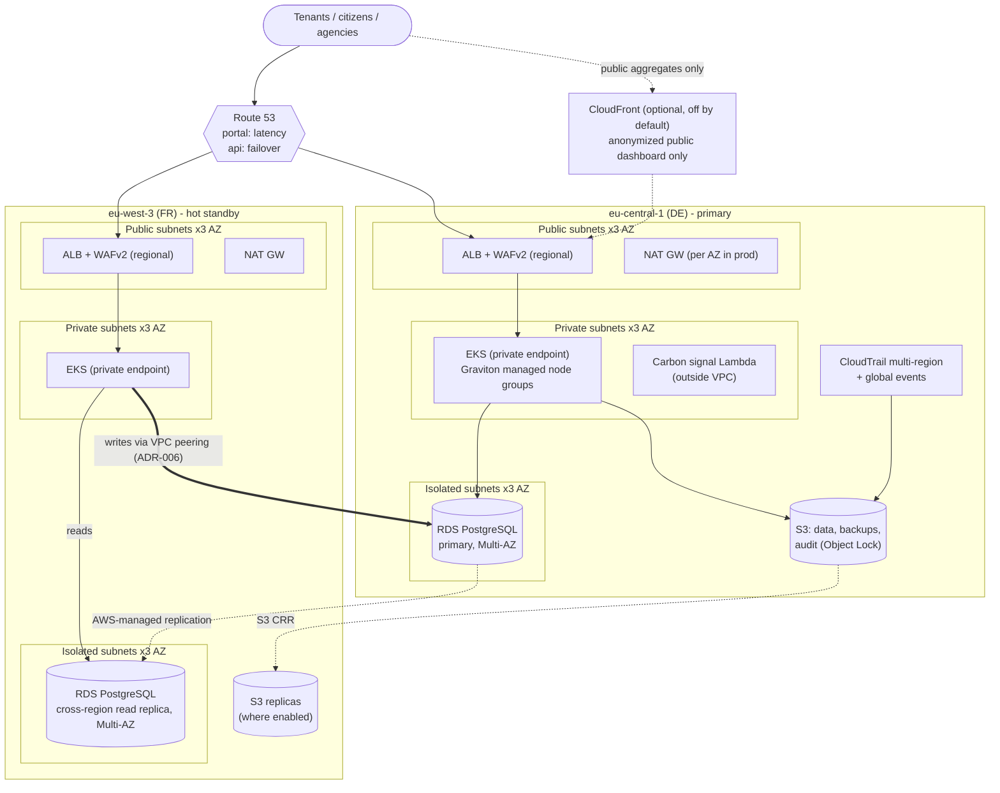

# Hestia platform architecture

Hestia is an EU building-renovation digital public infrastructure (DPI) platform. This document describes the AWS infrastructure provisioned by `terraform/`. The decisions behind it are recorded in [`adr/`](adr/).

## Scope and principles

- **Regions:** `eu-central-1` (DE, primary writer) and `eu-west-3` (FR, hot standby and local reads). No other region holds data. The `us-east-1` exceptions are closed and documented in [ADR-005](adr/005-global-services-and-gdpr.md).
- **Environments:** `dev`, `staging` and `prod`, one AWS account each. Each has four Terraform roots, `live/<env>/{de,fr,peering,edge}` ([ADR-002](adr/002-directories-vs-workspaces.md)).
- **Naming:** `hestia-<env>-<region_code>`, where `region_code` is `de` or `fr`.
- **Mandatory tags:** `hestia:environment`, `hestia:region`, `hestia:owner`, `hestia:cost-center`, `hestia:data-classification`, `hestia:tenant`, `hestia:workload`.
- **Secrets:** never stored in Terraform. They are referenced only by Secrets Manager ARN or SSM SecureString name and fetched at run time through IRSA or task roles. See [`secrets-handling.md`](secrets-handling.md).

## Topology

**Subnet tiers.** Each VPC is a `/16` with three tiers across three AZs.

| Tier | Contents | Route to internet |
|---|---|---|
| Public | ALBs, NAT gateways | Internet gateway |
| Private | EKS nodes, interface VPC endpoints | NAT (one per AZ in prod); peer CIDR via peering |
| Isolated | RDS | None; peer CIDR via peering only |

**CIDRs:** dev `10.10/16` (DE) and `10.11/16` (FR); staging `10.20/16` and `10.21/16`; prod `10.30/16` and `10.31/16` ([ADR-006](adr/006-network-connectivity.md)).

## Why active-passive writes with active-active reads

Summary of [ADR-003](adr/003-active-passive-vs-active-active.md):

- **Writes go to one region.** Subsidy, disbursement and green-bond records need a single, linear audit history. Multi-writer PostgreSQL would require conflict resolution, and a conflicting disbursement record cannot be "resolved" after the fact.
- **Reads are served in both regions.** The portal is read-heavy. FR users read from the local replica, and Route 53 latency routing sends them there.
- **Failover is two-stage.**
  1. Route 53 health checks move traffic automatically. FR serves read-only.
  2. A human promotes the FR replica.

  Automatic promotion is refused because a network partition would create two writers (split brain).
- **Cost.** FR is a hot standby (replica and node groups always running). This is accepted, because outages close to subsidy deadlines harm citizens directly.

## Data flows

| # | Flow | From → to | Path | Encryption in transit | At rest | Region(s) |
|---|---|---|---|---|---|---|
| 1 | Portal/API requests | User → ALB | Internet, TLS 1.2+ (ELB security policy) | TLS terminated at the regional ALB | — | DE or FR |
| 2 | App → DB (local) | EKS → RDS | VPC, private → isolated subnet | TLS (`rds.force_ssl = 1`) | KMS CMK (region-local) | DE, FR (reads) |
| 3 | FR writes | FR EKS → DE RDS writer | Inter-region VPC peering | AWS peering encryption + TLS | KMS CMK (DE) | FR → DE |
| 4 | DB replication | DE RDS → FR replica | AWS-managed RDS replication | AWS-managed TLS | KMS CMK (FR key) | DE → FR |
| 5 | Object replication | DE S3 → FR S3 | AWS-managed S3 CRR (opt-in per bucket and environment) | TLS | SSE-KMS (destination key) | DE → FR |
| 6 | Audit logs | All services → CloudTrail → audit bucket | AWS-managed | TLS | SSE-KMS; Object Lock (COMPLIANCE in prod) | DE (FR via CRR) |
| 7 | App logs | EKS → CloudWatch Logs → S3 export | AWS-managed | TLS | KMS CMK | Region-local |
| 8 | Secrets | Workload → Secrets Manager / SSM SecureString | VPC interface endpoint | TLS | KMS CMK | Region-local |
| 9 | Carbon signal | Lambda → ENTSO-E API → SSM / CloudWatch | Internet (Lambda outside the VPC) | TLS | — (non-personal data) | DE, FR |
| 10 | Cost and carbon exports | BCM Data Exports → DE S3 → Athena | AWS-managed | TLS | SSE-KMS | Control plane `us-east-1`; data in DE |
| 11 | Public dashboard (optional) | User → CloudFront → DE ALB | Internet | TLS | Edge cache: anonymized aggregates only | Global edge |

No flow carries personal data outside `eu-central-1` or `eu-west-3`.

## Global-service metadata exposure

Global-service metadata may be processed outside the two EU regions. **None of it is personal data**, as long as the naming and tagging rules hold. Those rules are enforced by `policies/gdpr.rego`. Details and compensating measures are in [ADR-005](adr/005-global-services-and-gdpr.md).

| Service | Metadata held globally / in `us-east-1` | Contains personal data? |
|---|---|---|
| IAM / STS | Role and policy names, policy documents | No |
| Route 53 | Zone and record names, ALB DNS targets, health check configuration | No |
| Organizations / SCPs | Account names, OUs, SCP text | No |
| Billing / BCM Data Exports | Usage line items, resource IDs, tag values (pseudonymous tenant IDs) | No |
| CloudFront (off by default) | Distribution configuration, cached anonymized public content | No |
| ACM `us-east-1`, WAF CLOUDFRONT | Certificate SANs, WAF rule configuration | No |

CloudTrail is homed in DE with `include_global_service_events = true`, so the **audit trail** of these services stays in the EU.

## Failure modes, RPO and RTO

These are **prod** targets. dev and staging have no RTO commitment.

| Failure | Detection | Automatic response | Human action | RPO | RTO |
|---|---|---|---|---|---|
| Single AZ loss (either region) | ALB/EKS health, RDS event | RDS Multi-AZ failover; node groups rebalance; per-AZ NAT keeps egress | None | 0 (synchronous standby) | Minutes |
| DE regional outage | Route 53 health checks, CloudWatch alarms | DNS moves `portal` and `api` to FR; FR serves **read-only** | Promote the FR replica, switch FR to read-write, scale FR ([runbook](runbook.md)) | Replica lag at failure, normally seconds; alarm > 60 s | Reads: minutes. Writes: **≤ 1 h** |
| FR regional outage | Route 53 health checks | DNS sends all traffic to DE | Rebuild the replica after recovery | 0 for writes (DE unaffected) | Minutes |
| Peering failure | VPC/CloudWatch, app errors | FR writes fail; FR reads continue | Investigate. If prolonged, route FR writes to DE via DNS. | 0 | Minutes to 1 h |
| Replica lag spike | `ReplicaLag` alarm | None | Investigate; delay planned failover | Lag value | — |
| Logical corruption or bad deploy | Monitoring, users | None. Replication copies the corruption. | Point-in-time restore from automated backups / AWS Backup into a new instance | To the chosen restore point | Hours |
| KMS key unavailable or scheduled for deletion | CloudTrail, Security Hub | SCP denies `ScheduleKeyDeletion` in prod | Cancel deletion; restore the key policy | 0 | Minutes |
| Carbon signal stale (> 1 h) | Metric age alarm | Batch jobs **fail open** (run immediately) | Fix the collector | n/a | n/a |
| Terraform state bucket region down | S3 errors | None | Per-region state ([ADR-004](adr/004-state-locking.md)): the other region's root stays operable | n/a | n/a |

## Policy enforcement

Four layers: variable validation, provider guards, OPA/Rego, and SCPs. See [ADR-007](adr/007-policy-as-code.md). No agent or CI pipeline runs `terraform plan` or `apply`. Validation is static only. Plan and apply are human-gated (see `runbook.md`).

## Carbon and sustainability

Carbon-aware batch scheduling uses the ENTSO-E grid signal. Per-tenant attribution uses BCM Data Exports and Athena. The voluntary EED Art. 12-aligned report and the query carbon-label coefficients are covered in [ADR-008](adr/008-carbon-aware-scheduling.md).

## Out of scope

Explicit cuts:

- Karpenter
- a dedicated log-archive account (the prod SCP requirement is tracked in `hestia-89g.23`)
- application code
- `terraform test`
- the AWS European Sovereign Cloud (documented as a migration path in ADR-005)
